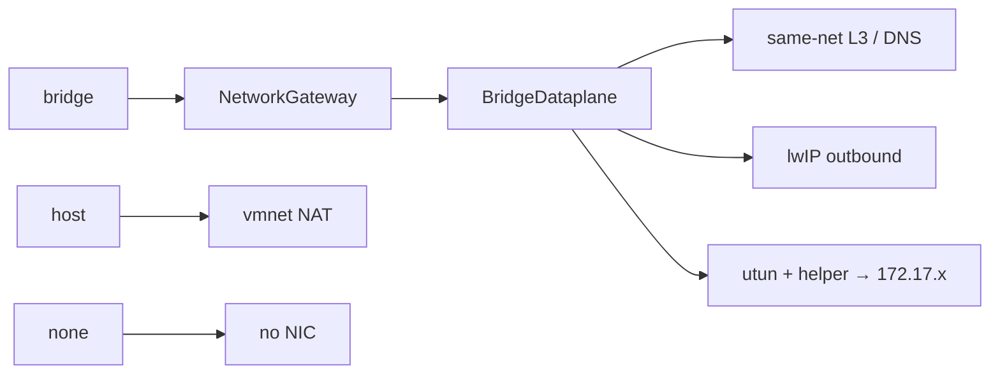

# Macker

macOS-native Linux containers. The daemon speaks the Docker Engine API over a UNIX socket and boots each container in a MicroVM (Apple `containerization` + Virtualization.framework).

| Path | What it is |
| --- | --- |
| `App/` | SwiftUI GUI (`io.macker.app`) |
| `Sources/` | SPM: products `mackerd` / `macker` / `macker-helper` (targets `Daemon` / `Cli` / `Helper`) |

Requirements: Apple Silicon, macOS 15+ (MicroVMs). Container networking (`bridge` / `host`) requires macOS 26+.

## Local debug

Do not run `macker setup` unless you intend to rewrite your `docker` alias and `/var/run/docker.sock`. Kernel/initfs come from `fetch-runtime`.

```bash
git submodule update --init --recursive

make fetch-runtime   # guest kernel + vminit → daemon store
make run             # build, ad-hoc sign, start the daemon
```

In another terminal:

```bash
./.build/debug/macker doctor
./.build/debug/macker pull hello-world
./.build/debug/macker run --rm hello-world
```

`run` / `create` pull the image if it is missing locally. First `start` can take a while (unpack rootfs + boot the VM).

Container records survive daemon restart (`ps -a`). MicroVMs do not: a graceful stop marks them `Exited (143)`; a crash marks them `Exited (255)`. `--rm` containers that were running are removed on restore. `ps` hides stopped containers.

Stop the daemon with Ctrl+C, then wipe images / containers / volumes / networks (keeps kernel and initfs):

```bash
make reset
```

## Run, attach, and exec

Foreground `run` attaches live stdio (create → attach → start). `-i` keeps stdin open; `-t` allocates a guest TTY (raw host terminal + window resize). `attach` reconnects to a running container. `exec` starts another process in a running MicroVM.

```bash
./.build/debug/macker run --rm alpine echo hello
./.build/debug/macker run --rm -it alpine sh
./.build/debug/macker run -dit --name sh alpine sh
./.build/debug/macker attach sh
./.build/debug/macker run -d --name web -p 18080:80 nginx
./.build/debug/macker exec web cat /usr/share/nginx/html/index.html
./.build/debug/macker exec -it web sh
echo hello | ./.build/debug/macker exec -i web cat
```

Official `nginx` does not include `wget` / `curl`. Use `cat` on the static files, or `exec` into `alpine`.

| Flag | `run` / `exec` | Effect |
| --- | --- | --- |
| `-d` | both | Detach; `run` prints the container ID |
| `-i` | both | Forward stdin |
| `-t` | both | Guest PTY; host raw mode when stdin/stdout are TTYs |
| `--rm` | `run` | Remove the container when it exits |
| `-w` / `-e` / `-u` | `exec` | Working dir, env, user |

Without `-t`, Ctrl-C on foreground `run` stops the container. `attach` without a TTY proxies SIGINT/SIGTERM/SIGHUP/SIGQUIT; with a TTY, `ctrl-p ctrl-q` detaches and leaves the container running. `exec` without `-t` proxies the same signals to the exec process, not the container. `Ctrl-D` / `exit` should restore the host terminal (`stty sane` if it does not).

## Copy files

`macker cp` talks to `GET`/`PUT /containers/{id}/archive`. The container must be running (the writable rootfs lives in the MicroVM).

```bash
./.build/debug/macker cp notes.txt web:/tmp/notes.txt
./.build/debug/macker cp web:/etc/hosts ./hosts
./.build/debug/macker cp web:/etc/hosts -
```

## Export, diff, and commit

`export` writes the container filesystem as a tar. `diff` lists paths added (`A`), changed (`C`), or deleted (`D`) since the image was unpacked. `commit` adds those changes as a new image layer on top of the parent.

Running containers are snapshotted through the guest. A stopped container still works if `rootfs.ext4` is on disk (until the next `start` or a daemon restart of a previously running container). Paused containers are rejected. Volume/bind mounts are omitted from `diff` / `commit`. `--pause` is accepted and ignored: the snapshot cannot freeze the MicroVM and still talk to the guest.

```bash
./.build/debug/macker run --name box alpine sh -c 'echo hi > /hello'
./.build/debug/macker diff box
./.build/debug/macker export -o box.tar box
./.build/debug/macker commit box myhello:latest
./.build/debug/macker run --rm myhello cat /hello
```

## Build

`macker build` is the classic Docker builder: the CLI applies `.dockerignore` and uploads a context tar to `POST /build`, the daemon interprets the Dockerfile, and each `RUN` executes in a throwaway MicroVM. **buildx / BuildKit is not implemented** — `POST /session` stays 404 and `GET /info` reports `BuilderVersion: "1"`.

```bash
cat > Dockerfile <<'EOF'
FROM alpine AS build
WORKDIR /src
COPY . .
RUN echo "built at $(date)" > /out.txt

FROM alpine
COPY --from=build /out.txt /out.txt
CMD ["cat", "/out.txt"]
EOF
./.build/debug/macker build -t demo:latest .
./.build/debug/macker run --rm demo:latest
./.build/debug/macker builder prune          # drop cached intermediate images
```

`-t` (repeatable), `-f`, `--build-arg`, `--label`, `--target`, `--no-cache`, `--pull`, and `-q` behave as usual, as do multi-stage builds, `COPY --from`, and `ADD` with a remote URL or an auto-extracted tar. Intermediate images are stored untagged, so `images -a` shows them and `builder prune` (or `image prune`) reclaims them. Because every `RUN` boots a VM, the layer cache matters: a cache key is the parent digest plus the normalized instruction, plus a content hash for `COPY` and the resolved value for `ARG`.

`macker setup` aliases `docker` to `macker`, so `docker build` lands here. The official `docker` binary talking straight to `macker.sock` defaults to BuildKit on 23+ and will fail — use `macker build` or `DOCKER_BUILDKIT=0 docker build`. BuildKit-only syntax (`# syntax=`, heredocs, `RUN --mount`, `--secret`, `--ssh`, cache mounts, bake, multi-platform) is out of scope for this release; the follow-up is to reuse BuildKit plus [container-builder-shim](https://github.com/apple/container-builder-shim) and wire the host side to macker's store — see [docs/buildkit.md](docs/buildkit.md). Command support and option gaps are in [docs/cli.md](docs/cli.md).

## Socket

The daemon listens on:

`~/Library/Application Support/io.macker.daemon/macker.sock`

Override with `--socket`, `--store` (isolated data dir; socket defaults to `<store>/macker.sock`), `MACKER_HOST`, or `DOCKER_HOST` (`unix://…` or an absolute path). Only one daemon may own a given store (`daemon.lock` in that directory); a second daemon exits with an explicit already-running error.

`/var/run/docker.sock` is Docker’s name. Only `macker setup` (optionally `--force`) creates a symlink to `macker.sock`. Leave it alone if it already points at Podman or Docker Desktop.

## Networking

Each container is a MicroVM with its own kernel, so this is not Linux `bridge` + `veth`. Docker network names still apply; the paths underneath do not. Diagrams and the helper/utun path are in [docs/networking.md](docs/networking.md).



| `--network` | What Macker does |
| --- | --- |
| `bridge` (default) | One virtio-net (VZ socketpair) to a userspace L3 dataplane (`eth0` is `/32`, DNS/next-hop `192.168.255.1`). Same-network containers reach each other by IP and name. Extra bridges add another `/32` on the same `eth0`. `-p` publishes on the Mac: with `sudo macker helper install` it `connect`s the container IP over utun; without the helper it uses an lwIP localhost relay. The helper also adds a utun route so the Mac can `curl <containerIP>`. `--internal` is same-network only. |
| `host` | Per-network vmnet NAT. `-p` is ignored. Image `EXPOSE` is published 1:1 on the Mac (`80` → `localhost:80`). Guest `127.0.0.1` is **not** the Mac loopback. |
| `none` | No NIC. |

`macker network ls|create|rm|inspect|connect|disconnect|prune` works. Builtin `bridge` / `host` / `none` cannot be removed. Running `connect` / `disconnect` on an extra bridge adds or removes an address on `eth0`. Connecting a running container that has no bridge NIC yet still needs a stop/start (MicroVMs cannot hot-plug virtio-net). Names resolve through the gateway; `/etc/hosts` is localhost only.

lwIP is outbound NAT (and `-p` only when utun is down). utun is the Mac → container-IP route, and the `-p` path when the helper is installed. Neither path installs `pf`.

```bash
./.build/debug/macker network ls
./.build/debug/macker run --rm alpine wget -qO- https://example.com
./.build/debug/macker run -d --name web -p 18080:80 nginx
curl http://127.0.0.1:18080
sudo ./.build/debug/macker helper install   # once; then restart the daemon
curl http://172.17.0.2                      # container IP from `inspect`
./.build/debug/macker run -d --name hostweb --network host nginx
curl http://127.0.0.1:80
```

Host-mode `curl localhost:80` uses the image `EXPOSE` 1:1 proxy, not `-p`. Binding Mac port 80 fails if something else already owns it.

vmnet NAT uses the same `com.apple.security.virtualization` entitlement as Apple’s containerization examples. `com.apple.vm.networking` is restricted; claiming it on an ad-hoc signed daemon gets the process SIGKILL’d at launch.

## Roadmap

Daily `bridge` / `host` / `none`, plus `run -it` / `exec`, is in place. Supported commands and option completeness are in [docs/cli.md](docs/cli.md). How bridge, vmnet, utun, and lwIP fit together is in [docs/networking.md](docs/networking.md).

## Make targets

Run these from the repo root. Prefer Make over calling `scripts/` directly.

| Target | Purpose |
| --- | --- |
| `app` | Debug-build the daemon and ad-hoc sign it |
| `macker` | Debug-build the CLI and `macker-helper` |
| `helper` | Debug-build `macker-helper` |
| `run` | `app`, then start the daemon |
| `sign` | Re-sign an already-built debug `mackerd` |
| `fetch-runtime` | Download the pinned kernel + vminit into the store |
| `reset` | Delete store `content/`, `containers/`, `volumes/`, `networks/` |
| `cli` | Release CLI prefix in `dist/cli` |
| `dist` | CLI prefix + `macker-VERSION-darwin-arm64.tar.gz` + Homebrew formula |
| `install` | Copy `dist/cli` to `PREFIX` (default `/usr/local`) |
| `bundle` | Release `dist/MackerDaemon.app` (signing shell, not the GUI) |
| `pkg` | Release `.app` + `dist/MackerDaemon.pkg` |
| `check` | Fail if `RuntimePin.json` ≠ containerization submodule tag |
| `sync-runtime` | Show or set pins (`ARGS='containerization 0.42.0'`) |
| `sync-runtime-latest` | Bump pins to GitHub latest stable |
| `test` | Run unit tests (CLI + REST + engine; no MicroVM) |
| `smoke` | Signed daemon + alpine `run --rm` / `exec` / `-p` on an isolated `--store` (`SMOKE_SKIP_VM=1` skips MicroVMs) |

```bash
VERSION=1.2.3 make dist
VERSION=1.2.3 make pkg
make sync-runtime ARGS='kata 3.28.0'
```

Debug builds report version `0.0.0`. Pass `VERSION=` (or `MACKER_VERSION=`) when packaging.

CLI layout (`docs/packaging.md`): `bin/macker` + `bin/mackerd` are exec wrappers around `libexec/macker/` (binaries + SwiftPM `*.bundle`). Guest kernel/initfs live in `share/macker/runtime/`.

```bash
VERSION=0.1.0 make dist
brew install --formula dist/homebrew/Formula/macker.rb
brew services start macker
```

## Scripts (`scripts/`)

Make targets call these. They are not only for local debug.

| Script | Used by | Role |
| --- | --- | --- |
| `sign-app.sh` | `make app` / `sign` | Ad-hoc sign the debug daemon (`com.apple.security.virtualization`) |
| `fetch-runtime.sh` | `make fetch-runtime`; packaging if `.runtime` is missing | Install kernel/initfs into the store; optional staging dir |
| `reset-store.sh` | `make reset` | Wipe engine state; keep `runtime/`, `initfs.ext4`, `daemon-id` |
| `package-cli.sh` | `make cli` / `dist` / `install` | CLI prefix, tarball, Homebrew formula |
| `package.sh` | `make bundle` / `pkg` | Release `.app` (`package.sh`) or `.app`+`.pkg` (`package.sh pkg`) |
| `sync-runtime.sh` | `make check` / `sync-runtime*` | Edit pins and the submodule; does not download artifacts |
| `lib.sh` | sourced by the others | Shared paths and helpers |

`fetch-runtime` and `sync-runtime` stay separate: one downloads the current pin, the other changes the pin.

## Store and pins

Daemon data lives in `~/Library/Application Support/io.macker.daemon/`:

- `macker.sock` — API socket (removed when the daemon exits)
- `runtime/vmlinux`, `initfs.ext4` — guest kernel and initfs
- `content/`, `volumes/`, `containers/`, `networks/`, `auth.json` — engine state (`make reset` keeps `auth.json`). Container metadata is `containers/<id>.json`; MicroVM disks under `containers/<id>/` are recreated on each start.

Guest versions are pinned in `Sources/ContainerEngine/RuntimePin.json` (`containerization`, `kata`). `.runtime/` is a packaging cache only (gitignored), not the runtime store.

## GUI

Open `App/Macker.xcodeproj`. Debug uses Xcode’s default `MARKETING_VERSION` (`1.0`). Archive with:

```bash
xcodebuild -project App/Macker.xcodeproj \
  MARKETING_VERSION=1.2.3 CURRENT_PROJECT_VERSION=42
```
