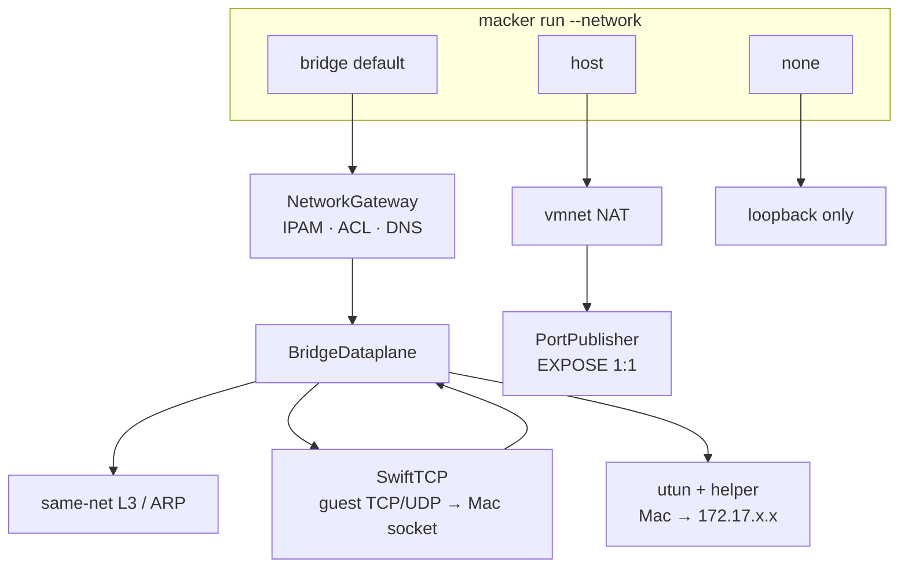
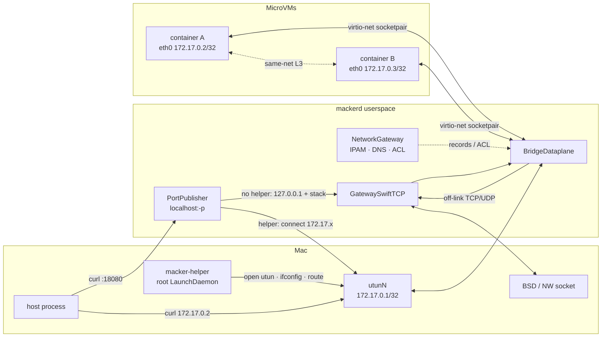
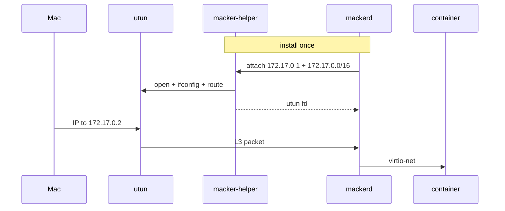
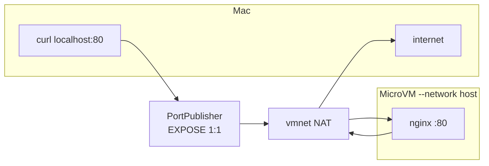

# Networking model

Each container is a MicroVM with its own kernel. There is no Linux `bridge` + `veth` here; Docker network names still apply, the paths underneath do not.

Container networking (`bridge` / `host`) requires macOS 26+.

## Which mode

| `--network` | Dataplane | How the Mac reaches the container | Outbound |
| --- | --- | --- | --- |
| `bridge` (default) | virtio-net (VZ socketpair) ↔ [`BridgeDataplane`](../Sources/ContainerEngine/BridgeDataplane.swift) | `-p` → localhost; with the helper, also `curl <containerIP>` | in-process SwiftTCP → Mac socket |
| `host` | Apple **vmnet NAT** | image `EXPOSE` mapped 1:1 on the Mac (`-p` ignored) | vmnet NAT |
| `none` | no NIC | unreachable | none |

`macvlan` / `ipvlan` / `--net=container:` are unimplemented. `bridge` supports dual-stack IPv6 when `--ipv6` is enabled on the network (NDP NS/NA + RS/RA, same-net L3, AAAA DNS, outbound TCP/UDP/ICMPv6, `utun` `-inet6` host routes, and bracketed `-p [::1]:hostPort:containerPort`). IPv6-only (`--ipv4=false`) and `host`-mode IPv6 are not supported.



---

## `bridge`: userspace gateway

Default subnet `172.17.0.0/16`. Each MicroVM has one virtio-net whose peer is the in-process gateway, not a Linux bridge. Apple only exposes that NIC to userspace as a **datagram `socketpair`** (`VZFileHandleNetworkDeviceAttachment`): one fd goes to Virtualization.framework, the other is read by [`BridgeDataplane`](../Sources/ContainerEngine/BridgeDataplane.swift). [`NetworkGateway`](../Sources/ContainerEngine/NetworkGateway.swift) is the control plane (IPAM, records, ACL); it does not sit on the packet hot path.

The guest has `lo` plus a single `eth0`: the address is a **`/32`**. The default route, DNS, and ARP next hop are that network's gateway (default **`172.17.0.1`**). IPAM skips `.1`; container addresses start at `172.17.0.2`. Extra bridges add another `/32` and an on-link route to that network's `.1`.

`network connect` to another bridge adds a `/32` on the same `eth0`; it does not hot-plug a second NIC. A running container with no bridge NIC yet (`none` or host-only) cannot hot-plug virtio-net.



### Where each flow goes

**Same network (container → container)**  
`BridgeDataplane` checks whether both ends share a Docker network. If they do, it L3-forwards onto the peer's virtio socketpair (both IPv4 and IPv6). ARP, NDP (NS/NA and RS/RA), ping/ping6 to the gateway, and embedded DNS (A and AAAA) stay in the dataplane (records published by `NetworkGateway`). Traffic does not go through SwiftTCP or utun. `--internal` allows only this path.

**Outbound (container → example.com)**  
Destination is off-link and not a network gateway: TCP/UDP is handed to in-process **SwiftTCP** (guest session terminated, payload on a Mac socket). ICMP echo (`ping 8.8.8.8`) goes out a Mac ICMP datagram socket. Other ICMP types are dropped. Pinging the gateway stays in the dataplane.

**`-p` (Mac → localhost:published port)**  
`PortPublisher` always listens on the Mac.

- **Helper / utun ready:** it `connect`s `containerIP:containerPort` from that network's gateway IP, so the guest sees SYN from `.1`. The kernel sends those packets into utun; the dataplane forwards them to the guest. No SwiftTCP on this path.
- **No helper:** it relays to `listenLocal`, and the userspace stack opens toward the guest. This still works without a host route.

**Mac → container IP (`curl 172.17.0.2`)**  
Needs a host route, the `docker0` equivalent. A signed `mackerd` cannot `connect(utun)` on macOS 26 (`EPERM`), so:

1. Once: `sudo macker helper install` (root LaunchDaemon; later boots do not prompt)
2. The daemon sends `attach`; the helper opens utun, runs `ifconfig` / `route`, and passes the fd back with `SCM_RIGHTS`
3. The Mac routes `172.17.0.0/16` → `utunN`; packets enter the dataplane and are delivered to the container. Extra user bridges get another subnet route and a gateway alias (`add-address`) on the same utun.

Without the helper, utun is disabled quietly; `-p` falls back to the userspace stack and outbound is unaffected. `macker doctor` checks the helper.

**Container → gateway IP (host services / `HTTP_PROXY=http://172.17.0.1:…`)**  
With the helper, non-DNS/ICMP packets aimed at a network `.1` go out utun onto the Mac. Without the helper, only DNS and ping-to-gateway are answered in-process; other ports are dropped.



### Addresses

| Who | Address | Meaning |
| --- | --- | --- |
| container `eth0` | `172.17.0.2/32` (first on the default net) | IPAM allocation; the IP inspect shows |
| inspect `Gateway` / guest default route / DNS | `172.17.0.1` | that network's gateway; guest on-link `/32` peer |
| extra bridge | `172.18.0.2/32` + on-link `172.18.0.1` | same `eth0`; its own gateway IP |
| Mac `utunN` | `172.17.0.1/32` (plus aliases) | host entry into container subnets |
| host route | `172.17.0.0/16` → utun | written by the helper; each extra user bridge adds another subnet route and gateway alias |

### Names and DNS

Peer names (`web`, `web.bridge`, 12-char ID prefix, aliases) resolve at the gateway. `/etc/hosts` is localhost, the container's own hostname/name/ID, and `--add-host`. `host-gateway` in `--add-host` is that network's `.1`.

Queries the gateway does not own are recursed upstream, following macOS `State:/Network/Global/DNS` (Clash/Surge often `127.0.0.1`). `--dns` overrides. If the Mac has no IPv4 resolver, the last resort is `1.1.1.1` / `8.8.8.8`.

### `--internal`

Same-network traffic works. No outbound NAT, no off-link ICMP, and no recursive DNS to upstream resolvers. Name lookup still hits the gateway, which only answers records on networks the caller is attached to.

---

## `host`: vmnet NAT

`--network host` is not Linux “join the host netns”. Each host network is an Apple **vmnet** NAT (Virtualization.framework). The container has its own address (planned default `172.19.0.0/16`; the live subnet is whatever vmnet assigned).

Guest `127.0.0.1` is **not** the Mac loopback. `-p` is discarded. Image `EXPOSE` (and create `ExposedPorts`) are mapped 1:1 by `PortPublisher`: `80` → `localhost:80`. Binding Mac port 80 fails if something else already owns it.

Outbound is vmnet NAT. It does **not** use SwiftTCP or utun.



vmnet uses `com.apple.security.virtualization`. Do not claim `com.apple.vm.networking`: an ad-hoc signed daemon is SIGKILL’d at launch.

---

## `none`

No virtio-net, no vmnet. Guest `lo` only. `-p` is discarded.

---

## Component map

These are not interchangeable “NIC drivers”. They sit on different layers:

| Name | What it is | When it appears |
| --- | --- | --- |
| **bridge** | Docker network mode | default; `network create` currently only supports this driver |
| **NetworkGateway** | IPAM, endpoint records, DNS policy, ACL snapshots | any container attached to a bridge |
| **BridgeDataplane** | packet path: same-net L3, ARP, DNS, ping-to-gateway, utun, hand-off to SwiftTCP | same |
| **virtio-net** | MicroVM NIC, VZ datagram socketpair to the dataplane | bridge |
| **SwiftTCP** | in-process TCP/UDP library | bridge outbound (guest session terminated onto a Mac socket); `-p` only when utun is down |
| **PortPublisher** | listen on the Mac and relay | bridge `-p`; host `EXPOSE` 1:1 |
| **utun** | kernel tunnel, host-route entry | helper installed, and a bridge needs a host route |
| **macker-helper** | root LaunchDaemon | opens utun and runs `ifconfig` / `route` / `add-address`; `mackerd` stays unprivileged |
| **vmnet** | Apple NAT | `--network host` only |

The userspace stack is **not** the path for Mac → container IP, and not the path for `-p` when the helper is installed. utun is **not** outbound NAT and does not install `pf`. The helper does **not** create a permanent interface at install time — the utun fd is owned by the daemon process, and routes are torn down when the daemon exits.

Engine internals, Clash/Surge constraints, and throughput work are in [userspace-stack.md](userspace-stack.md).

---

## Commands

```bash
# bridge: outbound
macker run --rm alpine wget -qO- https://example.com

# bridge: -p (helper not required; with helper this also uses utun)
macker run -d --name web -p 18080:80 nginx
curl http://127.0.0.1:18080

# bridge: Mac → container IP (helper required)
sudo macker helper install
# restart the daemon, then start the container
macker inspect -f '{{range.NetworkSettings.Networks}}{{.IPAddress}}{{end}}' web
curl http://172.17.0.2

# host: EXPOSE 1:1, not -p
macker run -d --name hostweb --network host nginx
curl http://127.0.0.1:80

# none
macker run --rm --network none alpine ip addr
```

`macker helper status` / `macker doctor` show whether the helper is running. Re-run `sudo macker helper install` after rebuilding the helper binary.
