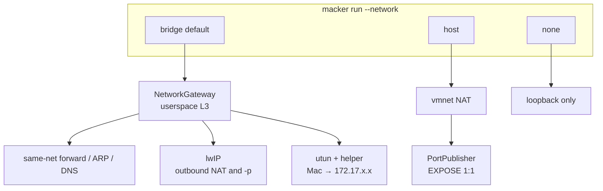
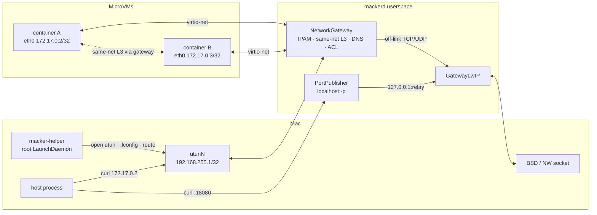
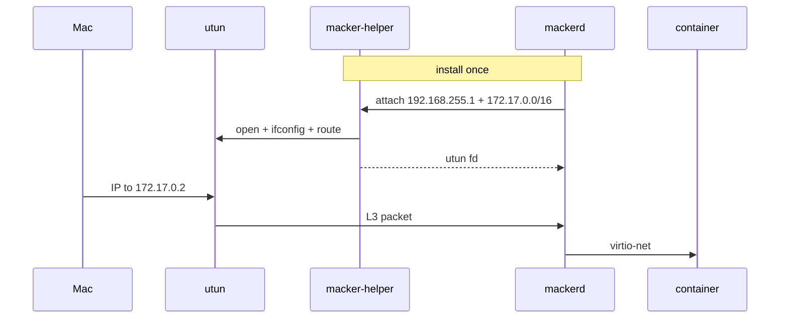
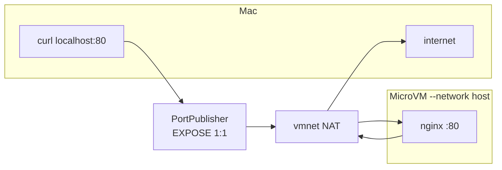

# Networking model

Each container is a MicroVM with its own kernel. There is no Linux `bridge` + `veth` here; Docker network names still apply, the paths underneath do not.

Container networking (`bridge` / `host`) requires macOS 26+.

## Which mode

| `--network` | Dataplane | How the Mac reaches the container | Outbound |
| --- | --- | --- | --- |
| `bridge` (default) | virtio-net ↔ userspace [`NetworkGateway`](../Sources/ContainerEngine/NetworkGateway.swift) | `-p` → localhost; with the helper, also `curl <containerIP>` | in-process lwIP → Mac socket |
| `host` | Apple **vmnet NAT** | image `EXPOSE` mapped 1:1 on the Mac (`-p` ignored) | vmnet NAT |
| `none` | no NIC | unreachable | none |

`macvlan` / `ipvlan` / `--net=container:` / IPv6 are unimplemented.



---

## `bridge`: userspace gateway

Default subnet `172.17.0.0/16`. Each MicroVM has one virtio-net whose peer is the in-process gateway, not a Linux bridge. The guest has `lo` plus a single `eth0`: the address is a **`/32`**, and the default route and DNS are **`192.168.255.1`** (not the `172.17.0.1` shown in inspect). `172.17.0.1` is a Docker-shaped gateway field that IPAM skips; container addresses start at `172.17.0.2`.

`network connect` to another bridge adds a `/32` on the same `eth0`; it does not hot-plug a second NIC. A running container with no bridge NIC yet (`none` or host-only) cannot hot-plug virtio-net.



### Where each flow goes

**Same network (container → container)**  
The gateway checks whether both ends share a Docker network. If they do, it L3-forwards. ARP, ping to the gateway, and embedded DNS stay in `NetworkGateway`. Traffic does not go through lwIP or utun. `--internal` allows only this path.

**Outbound (container → example.com)**  
Destination is off-link and not `192.168.255.1`: the TCP/UDP session is handed to **lwIP**. lwIP terminates the guest side, then sends payload out a Mac socket. Outbound ICMP (`ping 8.8.8.8`) is unimplemented; pinging the gateway works.

**`-p` (Mac → localhost:published port)**  
`PortPublisher` listens on the Mac, relays to lwIP `listenLocal`, and lwIP opens toward the guest. No host route is required; this works without the helper.

**Mac → container IP (`curl 172.17.0.2`)**  
Needs a host route, the `docker0` equivalent. A signed `mackerd` cannot `connect(utun)` on macOS 26 (`EPERM`), so:

1. Once: `sudo macker helper install` (root LaunchDaemon; later boots do not prompt)
2. The daemon sends `attach`; the helper opens utun, runs `ifconfig` / `route`, and passes the fd back with `SCM_RIGHTS`
3. The Mac routes `172.17.0.0/16` → `utunN`; packets enter the gateway and are delivered to the container

Without the helper, utun is disabled quietly; `-p` and outbound are unaffected. `macker doctor` checks the helper.



### Addresses

| Who | Address | Meaning |
| --- | --- | --- |
| container `eth0` | `172.17.0.2/32` (first on the default net) | IPAM allocation; the IP inspect shows |
| inspect `Gateway` | `172.17.0.1` | Docker-shaped field; the guest does **not** use it as next hop |
| guest default route / DNS | `192.168.255.1` | point-to-point peer; the userspace gateway |
| Mac `utunN` | `192.168.255.1/32` | host entry into container subnets |
| host route | `172.17.0.0/16` → utun | written by the helper; each extra user bridge adds another subnet route |

### `--internal`

Same-network traffic works. No outbound NAT and no recursive DNS to upstream resolvers. Name lookup still hits the gateway, which only answers records on networks the caller is attached to.

---

## `host`: vmnet NAT

`--network host` is not Linux “join the host netns”. Each host network is an Apple **vmnet** NAT (Virtualization.framework). The container has its own address (planned default `172.19.0.0/16`; the live subnet is whatever vmnet assigned).

Guest `127.0.0.1` is **not** the Mac loopback. `-p` is discarded. Image `EXPOSE` (and create `ExposedPorts`) are mapped 1:1 by `PortPublisher`: `80` → `localhost:80`. Binding Mac port 80 fails if something else already owns it.

Outbound is vmnet NAT. It does **not** use lwIP or utun.



vmnet uses `com.apple.security.virtualization`. Do not claim `com.apple.vm.networking`: an ad-hoc signed daemon is SIGKILL’d at launch.

---

## `none`

No virtio-net, no vmnet. Guest `lo` only. `-p` is discarded.

---

## Component map

These are not interchangeable “NIC drivers”. They sit on different layers:

| Name | What it is | When it appears |
| --- | --- | --- |
| **bridge** | Docker network mode | default; `network create` currently only supports this driver |
| **NetworkGateway** | in-daemon L3 control plane + same-net forward | any container attached to a bridge |
| **virtio-net** | the MicroVM NIC | bridge (point-to-point to the gateway) |
| **lwIP** | in-process TCP/UDP stack | bridge outbound NAT and the guest side of `-p` |
| **PortPublisher** | listen on the Mac and relay | bridge `-p`; host `EXPOSE` 1:1 |
| **utun** | kernel tunnel, host-route entry | helper installed, and a bridge needs a host route |
| **macker-helper** | root LaunchDaemon | opens utun and runs `ifconfig` / `route`; `mackerd` stays unprivileged |
| **vmnet** | Apple NAT | `--network host` only |

lwIP is **not** the path for Mac → container IP. utun is **not** outbound NAT and does not install `pf`. The helper does **not** create a permanent interface at install time — the utun fd is owned by the daemon process, and routes are torn down when the daemon exits.

---

## Commands

```bash
# bridge: outbound
macker run --rm alpine wget -qO- https://example.com

# bridge: -p (helper not required)
macker run -d --name web -p 18080:80 nginx
curl http://127.0.0.1:18080

# bridge: Mac → container IP (helper required)
sudo macker helper install
# restart the daemon, then start the container
macker inspect -f '{{range.NetworkSettings.Networks}}{{.IPAddress}}{{end}}' web
curl http://172.17.0.2

# host: EXPOSE 1:1, not -p
macker run -d --name hostweb --network host nginx
curl http://127.0.0.1:80

# none
macker run --rm --network none alpine ip addr
```

`macker helper status` / `macker doctor` show whether the helper is running. Re-run `sudo macker helper install` after rebuilding the helper binary.
